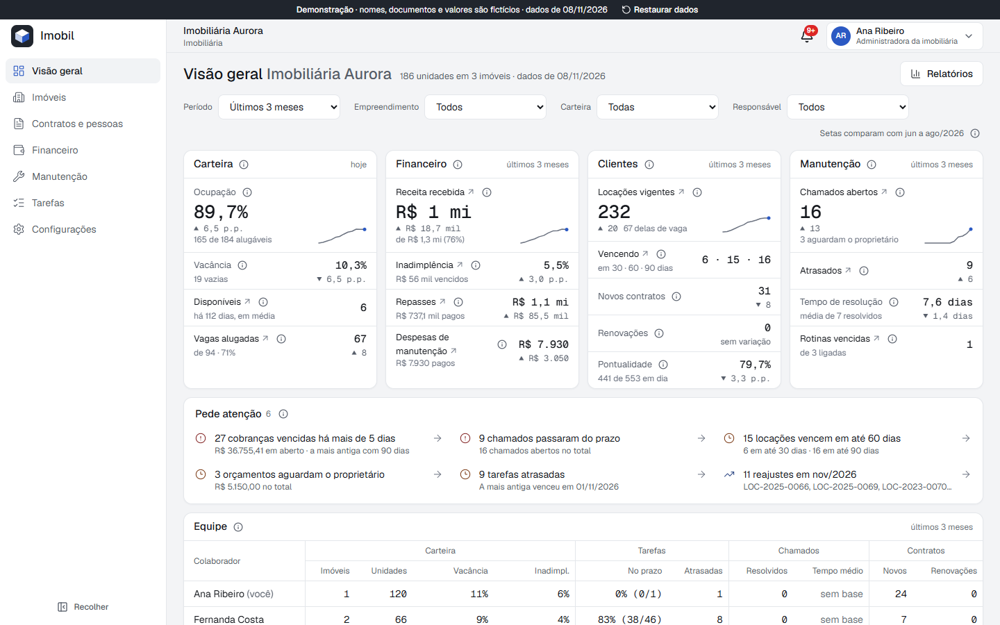

# Imobil

Modelo de um sistema de gestão de imóveis alugados (SaaS) para a imobiliária e para o proprietário que administra sozinho: imóveis, contratos, cobranças, repasses e manutenção, com portal do proprietário, do inquilino e do prestador. Tudo roda no navegador com dados fictícios, e a camada de dados já tem o formato do banco que vem depois (Supabase): trocar a fonte não muda as telas. Na mesma pasta mora o Condomínio, um app irmão para o dia a dia do prédio: o morador reserva lavanderia e diária, faz denúncia (anônima, se quiser) e lê os avisos pelo celular; a equipe atende pela web, com banco de verdade pronto para o Supabase.

**Demonstração:** https://fernandotrecruiter.github.io/imobil/demo/ · Condomínio: [morador](https://fernandotrecruiter.github.io/imobil/demo/condominio/) e [equipe](https://fernandotrecruiter.github.io/imobil/demo/condominio/equipe.html)



## O que tem

| Tela | O que faz |
|---|---|
| Visão geral | números da carteira, do financeiro, dos clientes e da manutenção, cada um com a seta que compara com o período anterior; o que pede atenção; desempenho da equipe |
| Imóveis | mapa de ruas com os imóveis, filtros e a tabela de imóveis, unidades ou vagas. A ficha de cada imóvel tem o 3D da implantação, unidades, contratos, manutenção e documentos |
| Contratos e pessoas | uma tabela cuja linha abre com as partes e os documentos; reajuste, renovação e rescisão |
| Financeiro | previsto, vencido, recebido, pago, baixa e repasse ao proprietário |
| Manutenção | chamados, vistorias e rotinas periódicas |
| Tarefas | tarefas, processos, automações e comunicados (e-mail simulado) |
| Configurações | empresa e tema, usuários e permissões, carteiras, situações e cores, auditoria, importar planilha |

As tabelas principais ordenam pelo cabeçalho, filtram com contagem, escolhem colunas e exportam para Excel ou CSV o que está filtrado.

## Abrir a demonstração

No ar, pelo link acima. No computador, baixe `docs/demo/index.html` e abra com dois cliques: é o app inteiro num arquivo só, sem servidor.

No canto de cima, **"Ver como"** troca a pessoa (faz o papel do login):

| Pessoa | O que enxerga |
|---|---|
| Ana Ribeiro, administradora da Imobiliária Aurora | tudo da imobiliária: Condomínio Luar, Condomínio Mount Juic e Lynx Residence |
| Bruno Teixeira, colaborador do financeiro | cadastros e contratos para ver; edita o financeiro e aprova repasse |
| Carlos Mendes, proprietário convidado | só as 4 unidades dele; aprova orçamento e renovação no portal |
| Daniela Freitas, inquilina | só o próprio contrato, a vaga, as cobranças, os chamados e os documentos |
| Eduardo Lima, prestador | só os chamados atribuídos a ele |
| Marina Lopes, proprietária independente | a conta dela: o Edifício Le Plaza, sem imobiliária e sem repasse |

O que você muda fica guardado só no seu navegador. "Restaurar dados", na faixa de cima, volta tudo ao original com a data de hoje.

## Rodar o código

Precisa do Node 22 ou mais novo.

```
npm install
npm run dev        # abre em http://localhost:5173
```

| Comando | O que faz |
|---|---|
| `npm test` | testes das regras, do isolamento entre papéis e organizações e das telas |
| `npm run lint` / `npm run build` | revisão do código / versão final em `dist/` |
| `npm run check` | os três acima |
| `npm run arquivo` | gera o `Imobil.html`, o app num arquivo só. A demonstração em `docs/demo/index.html` é uma cópia dele |
| `npm run powerbi` | gera a Visão geral para o Power BI em `powerbi/saida/` (ver `powerbi/LEIA-ME.md`) |

O Condomínio é outro app, com os próprios comandos: dentro de `condominio/`, `npm install` e `npm run dev` (http://localhost:5190). Ver `condominio/LEIA-ME.md`.

## Como é feito

- **Pilha:** Vite, React 19 e TypeScript; TanStack Router (cada filtro e escolha fica no endereço, então o Voltar funciona) e React Query; Tailwind e Radix; Leaflet no mapa; SheetJS para planilha; zod e react-hook-form nos formulários.
- **Camadas:** a tela pede os dados a um repositório, que aplica as regras de acesso por papel e organização (o espelho da segurança por linha que o banco vai ter) e lê de uma fonte. Hoje a fonte são dados fictícios gerados de uma semente fixa; só o que você altera vai para o `localStorage`.
- **Regras de dado:** dinheiro em centavos inteiros, data sem hora como texto `AAAA-MM-DD`, "vencido" e "ocupada" calculados na hora e nunca gravados.
- **Desenho:** o 3D isométrico é SVG feito à mão (sem Three.js) e os gráficos são CSS e SVG simples (sem biblioteca de gráfico).
- **Arquivo único:** `npm run arquivo` embute JavaScript, CSS e fontes num HTML só. Nesse build as rotas vão depois do `#`, por isso ele abre do disco e também numa subpasta do GitHub Pages.
- **Documentação:** `DOCUMENTACAO.md` (os dois apps), `docs/ARQUITETURA.md` (camadas e a troca para o banco), `docs/CONVENCOES.md` (como se faz uma tela), `docs/DECISOES.md` (cada escolha e o porquê) e `docs/PLANO.md` (o plano inicial).

## Testes

```
npm test                                  # Vitest, sem navegador
cd condominio && npm test                 # os testes do Condomínio
python tests/varredura.py --fotos         # com o npm run dev ligado
```

A varredura abre todas as telas com as 6 pessoas em 4 larguras e aponta erro de JavaScript, rolagem lateral e tela de erro. Precisa do Edge e de `pip install websocket-client`.

## Limites

- Sem banco nem login de verdade: é um modelo da interface com dados fictícios.
- Pagamento, e-mail e avisos são simulados; nada é cobrado nem enviado.
- O fundo do mapa usa os mapas de ruas da Esri, só para demonstração. Uso real pede uma conta num provedor de mapas e os termos dele.
- O CEP do cadastro de imóvel é buscado no ViaCEP pela internet; sem rede, o endereço é digitado à mão.
- A Visão geral no Power BI foi gerada e conferida com os dados de exemplo, mas ainda não foi aberta num Power BI de verdade.
- A varredura de telas procura o Edge no caminho padrão do Windows.
- "Imobil" é nome provisório.
