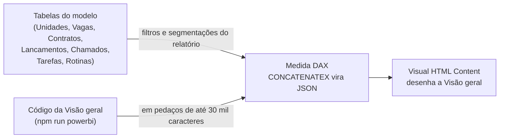

# A Visão geral dentro do Power BI

A mesma Visão geral do Imobil (os blocos Carteira, Financeiro, Clientes e Manutenção, a equipe somada e os alertas), rodando dentro de um visual **HTML Content** do Power BI e lendo as tabelas do seu modelo. É o caminho do `gera_powerbi.py` do people-analytics: uma medida monta o HTML inteiro e o visual desenha.

## Como funciona



1. O `scripts/gera-powerbi.mjs` monta a Visão geral num HTML só, sem internet (a fonte é a do sistema), e divide em pedaços: o DAX não aceita um texto de mais de ~32 mil caracteres.
2. A medida `MedidaVisaoGeral.dax` transforma as linhas das suas tabelas em JSON com `CONCATENATEX` e coloca em `window.DADOS_BRUTOS`, antes do código do painel.
3. O painel vê que chegou dado e usa ele no lugar dos dados fictícios. As contas e os textos são os mesmos da tela do app (`src/modules/visao-geral/macro.ts` e `figures.ts`), e o desenho dos blocos também (`Blocos.tsx`).
4. Segmentação e filtro do relatório filtram as tabelas **antes** da medida: o painel recebe só as linhas filtradas. RLS (segurança por linha) vale do mesmo jeito.

## O que o painel mostra

| Bloco | Números | Seta compara com |
|---|---|---|
| Carteira | ocupação (com a tendência de 12 meses), vacância, disponíveis e há quantos dias em média, vagas alugadas | o mesmo dia, N meses atrás |
| Financeiro | receita recebida de quanto foi previsto (tendência), inadimplência, repasses, despesas de manutenção | o período anterior, visto até o mesmo dia |
| Clientes | locações vigentes (tendência), vencendo em 30, 60 e 90 dias, novos contratos, renovações, pontualidade dos locatários | idem |
| Manutenção | chamados abertos (tendência), atrasados, tempo médio de resolução, rotinas vencidas | idem |
| Equipe | tarefas no prazo, tarefas atrasadas, chamados resolvidos: **a equipe somada** | idem |
| Pede atenção | cobranças vencidas, chamados atrasados, locações vencendo, orçamentos parados, tarefas atrasadas, reajustes do mês | |

"N meses" é o período escolhido no próprio painel. Com "Últimos 3 meses" em 04/11, as setas comparam setembro a novembro (visto até 04/11) com junho a agosto (visto até 04/08): nos dois lados o mês corrente tem só os mesmos dias, e o período atual não parece pior só porque o anterior já teve tempo de ser pago.

### Por que a equipe vai somada (e não por colaborador)

No app, o administrador vê o desempenho de cada colaborador e cada colaborador vê só o dele. Um relatório do Power BI costuma ser compartilhado (com sócios, proprietários, outras áreas), e tudo o que entra na medida fica visível para quem abre o relatório, inclusive no código da página. Desempenho por pessoa ali vira avaliação de colaborador exposta a quem não deve ver. Por isso as tabelas `'Tarefas'` e `'Chamados'` **não têm coluna de responsável**, e o painel mostra só o total da equipe. Não acrescente essa coluna na medida.

## O esquema: o que as tabelas precisam ter

Os nomes das colunas abaixo são os dos CSVs de exemplo. No seu modelo podem ser outros: troque na medida (passo 4). Texto de situação e categoria aceita o rótulo em português, com ou sem acento, ou o código do Imobil.

`'Vagas'`, `'Tarefas'` e `'Rotinas'` são opcionais: se o seu modelo não tem, troque o bloco da tabela na medida por `VAR _vagas = "[]"` (ou `_tarefas`, `_rotinas`) e o painel esconde o que depende dela. As colunas novas de 07/11/2026 (`[IdContratoAnterior]`, `[UltimoPagamento]`, `[Abertura]`, `[Conclusao]`) também podem vir vazias; o que depende delas fica sem base ou conta pelo lado seguro (dito em cada uma).

**'Unidades'**: uma linha por unidade alugável (apartamento, casa, sala, loja). Vaga de garagem fica fora (desde 06/11/2026): a ocupação fala de moradia e sala. No modelo de verdade, filtre o tipo "Vaga" antes da medida e mande as vagas em 'Vagas'.

| Coluna no modelo | Campo | Formato | Obrigatória |
|---|---|---|---|
| `[IdUnidade]` | id | texto ou número | sim |
| `[Unidade]` | code | texto ("A-301", "Casa") | sim |
| `[SituacaoManual]` | manual_status | "Disponível", "Reservada", "Em manutenção" ou "Bloqueada". "Ocupada" não vem daqui: sai do contrato vigente | não (vazio = disponível) |
| `[IdImovel]` | property_id | texto ou número | sim |
| `[Imovel]` | property_name | texto (o empreendimento) | sim |

**'Vagas'**: as vagas de garagem, com as mesmas colunas de 'Unidades' (`[IdUnidade]`, `[Unidade]`, `[SituacaoManual]`, `[IdImovel]`, `[Imovel]`). É delas o número "vagas alugadas". O contrato e a cobrança da vaga continuam em 'Contratos' e 'Lancamentos', com o `[IdUnidade]` da vaga.

**'Contratos'**: uma linha por contrato, vigentes e encerrados (o encerrado não ocupa a unidade hoje, mas conta na comparação com o período anterior).

| Coluna no modelo | Campo | Formato | Obrigatória |
|---|---|---|---|
| `[IdContrato]` | id | texto ou número | sim |
| `[Contrato]` | code | texto ("LOC-2025-0012") | sim |
| `[TipoContrato]` | kind | "Locação", "Administração" ou "Outro" | sim |
| `[Situacao]` | status | "Vigente", "Encerrado", "Rescindido", "Rascunho", "Em revisão", "Aguardando aprovação" ou "Aguardando assinatura" | sim |
| `[IdUnidade]` | unit_id | o mesmo id da tabela Unidades ou Vagas (vazio em contrato de administração) | só na locação |
| `[IdImovel]` | property_id | texto ou número | sim |
| `[Inicio]`, `[Fim]` | start_date, end_date | data | sim |
| `[Indice]` | adjustment_index | "IGP-M", "IPCA", "INPC", "Percentual fixo" ou "Sem reajuste" | não |
| `[MesReajuste]` | adjustment_month | número inteiro de 1 a 12 | não |
| `[IdContratoAnterior]` | parent_id | o `[IdContrato]` do contrato que este renova (vazio = locação nova) | não (vazio: toda locação conta como nova) |

**'Lancamentos'**: contas a receber e a pagar, uma linha por cobrança ou conta, dos últimos 12 meses até o que já está previsto. Para a seta do período anterior, mande também os 12 meses antes disso.

| Coluna no modelo | Campo | Formato | Obrigatória |
|---|---|---|---|
| `[IdLancamento]` | id | texto ou número | sim |
| `[Tipo]` | direction | "A receber" ou "A pagar" | sim |
| `[Categoria]` | category | "Aluguel", "Condomínio", "IPTU", "Taxa de administração", "Manutenção", "Repasse", "Caução" ou "Outro" | não (vazio = Outro) |
| `[Situacao]` | status | "Em aberto", "Pago" ou "Cancelado". "Vencido" é calculado (em aberto com vencimento antes de hoje); se vier, conta como em aberto | sim |
| `[Vencimento]` | due_date | data | sim |
| `[Valor]` | amount_cents | número em reais (a medida converte para centavos) | sim |
| `[ValorPago]` | paid_cents | número em reais, soma dos pagamentos até hoje (vazio = nada pago) | não |
| `[UltimoPagamento]` | paid_at | data do último pagamento | não (vazio: a cobrança paga fica fora da pontualidade e conta como paga antes da data de comparação) |
| `[IdImovel]` | property_id | texto ou número (vazio em repasse e taxa de administração) | não |

**'Chamados'**: chamados de manutenção. Sem coluna de responsável (ver acima).

| Coluna no modelo | Campo | Formato | Obrigatória |
|---|---|---|---|
| `[IdChamado]` | id | texto ou número | sim |
| `[Situacao]` | status | "Aberto", "Em triagem", "Orçamento", "Aguardando proprietário", "Aprovado", "Em execução", "Concluído" ou "Cancelado" | sim |
| `[IdImovel]` | property_id | texto ou número | sim |
| `[Prazo]` | due_date | data (vazio = sem prazo, nunca atrasa) | não |
| `[Orcamento]` | quote_cents | número em reais | não |
| `[Abertura]` | opened_on | data em que o chamado foi aberto | não (vazio: aberto desde sempre) |
| `[Conclusao]` | closed_on | data em que foi concluído ou cancelado | não (vazio: sem tempo de resolução) |

**'Tarefas'**: as tarefas da equipe (de processo ou avulsas). Sem coluna de responsável (ver acima).

| Coluna no modelo | Campo | Formato | Obrigatória |
|---|---|---|---|
| `[IdTarefa]` | id | texto ou número | sim |
| `[Situacao]` | status | "A fazer", "Fazendo", "Feito" ou "Cancelada" | sim |
| `[Prazo]` | due_date | data | não (sem prazo: nunca atrasa) |
| `[Conclusao]` | done_on | data em que ficou feita | não (vazio: a tarefa feita fica fora do "no prazo") |
| `[IdImovel]` | property_id | imóvel da unidade, do contrato ou do chamado ligado à tarefa | não (vazio: a tarefa some com uma segmentação de imóvel ligada) |

**'Rotinas'**: as rotinas de manutenção (limpeza de caixa d'água, extintores...).

| Coluna no modelo | Campo | Formato | Obrigatória |
|---|---|---|---|
| `[IdRotina]` | id | texto ou número | sim |
| `[IdImovel]` | property_id | texto ou número | sim |
| `[ProximaData]` | next_date | data da próxima execução | sim |
| `[Situacao]` | status | "Ligada" ou "Desligada" | não (vazio = ligada) |

Linha sem campo obrigatório fica de fora, e valor que o painel não reconhece conta pelo padrão da coluna. Nos dois casos o painel mostra um quadro "Conferir no modelo do Power BI" dizendo a tabela, a coluna e quantas linhas.

## Passo a passo

1. **Gere os arquivos**: na pasta do projeto, `npm run powerbi`. As saídas vão para `powerbi/saida/` (fora do git).
2. **Instale o visual**: Power BI Desktop > Visualizações > "Obter mais visuais" > procure **HTML Content** > Adicionar. É o mesmo visual do organograma em DAX, que executa o JavaScript do HTML.
3. **(Para testar antes)** Importe `Unidades.csv`, `Vagas.csv`, `Contratos.csv`, `Lancamentos.csv`, `Chamados.csv`, `Tarefas.csv` e `Rotinas.csv` (separador `;`, UTF-8, localidade Português (Brasil)). O nome de cada arquivo já é o nome da tabela que a medida espera. São os dados fictícios do app, no formato do esquema.
4. **Crie a medida**: Modelagem > Nova medida > apague o texto > cole o conteúdo de `MedidaVisaoGeral.dax` > Enter. Troque o nome de cada tabela (`'Unidades'`, `'Vagas'`...) e cada `[Coluna]` pelos do seu modelo; tabela que você não tem vira `"[]"` (ver o esquema). Não mexa nos blocos `_a1`, `_d1`... (são o código do painel). Troque também `_organizacao` pelo nome da sua carteira.
5. **Ligue as segmentações**: crie uma tabela de imóveis (`IdImovel`, `Imovel`) e relacione com o `[IdImovel]` das outras tabelas. A segmentação nessa tabela filtra tudo de uma vez.
6. **Coloque na tela**: arraste o visual HTML Content, ponha a medida `VisaoGeralHTML` em "Values" e estique o visual (recomendado 1280 x 800 ou mais).
7. **Confira**: com os CSVs de exemplo, troque na medida a linha do `_hoje` pela data dos CSVs (a linha pronta está no comentário logo acima dela). Os números têm de ser os de `powerbi/saida/conferencia.txt`, os mesmos da Visão geral do app naquele dia.

## Quando o código da Visão geral mudar

```
npm run powerbi
```
Depois cole a medida de novo (passo 4) e refaça só a troca de nomes. O gerador para com "PORTÃO VERMELHO" se os indicadores lidos dos CSVs não baterem com os calculados direto; nesse caso, não use a medida nova.

## Limites e cuidados

- **Clique não filtra o relatório**: o que você escolhe dentro do HTML (o período) não filtra os outros visuais do Power BI. O caminho contrário funciona: segmentações filtram o painel. Os números não abrem lista nenhuma (no app eles abrem).
- **Repasse e taxa de administração não têm imóvel**: com uma segmentação de imóvel ligada, essas linhas saem dos dados e o indicador de repasses cai. O mesmo vale para a tarefa sem imóvel.
- **Comparação com o período anterior**: a cobrança guarda só o dia do ÚLTIMO pagamento. Uma parte paga antes da data de comparação e o resto depois conta como nada pago naquela data. A situação escolhida à mão da unidade (bloqueada, reservada) não tem histórico: vale a de hoje.
- **"Hoje"**: a medida usa a hora do servidor menos 3 horas (Brasília, sem horário de verão). Se a sua carteira estiver em outro fuso, troque o `TIME(3, 0, 0)`.
- **Volume**: centenas a poucos milhares de linhas rodam bem (o exemplo tem 3.759 lançamentos). Muito mais que isso deixa o visual lento, porque tudo vira texto dentro da medida. Mande só os lançamentos que o período mais longo (12 meses) e a comparação precisam.
- **Tamanho do HTML**: 337,6 KB em 07/11/2026, perto do teto de 350 KB que o gerador vigia. Antes de pôr mais coisa no painel, enxugue algo.
- **Sem internet**: o painel usa a fonte do sistema (o desenho fica igual, a letra muda um pouco).
- **Privacidade**: tudo o que entra na medida fica visível para quem vê o relatório, inclusive no código da página. Não acrescente coluna que o público do relatório não pode ver (nome de inquilino, documento, telefone, responsável por tarefa ou chamado). Para separar clientes (uma imobiliária, vários proprietários), use RLS do Power BI: cada pessoa recebe só as linhas dela, antes da medida.
- **Não testado dentro do Power BI ainda**: daqui foi provado que o HTML único abre sem internet, que a medida tem 12 pedaços de no máximo 30 mil caracteres e que a leitura dos CSVs dá exatamente os mesmos números do app (870 valores, nos 4 períodos, em 07/11/2026). A primeira rodada no Power BI é com os CSVs de exemplo, conferindo o passo 7.
